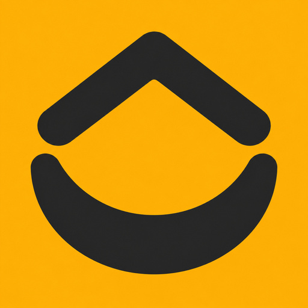

# 开发者信息（上架填写用）

> 这份是平台上架时「开发者信息」表单的填写内容，以及头像的制作/复现方法。
> 上架新技能时可直接复用本文件，只需按需替换简介中的技能名。

---

## 1. 开发者昵称

```
归巢实验室
```

- **全平台唯一**，提交时以平台实时校验为准。
- 备选（若被占用）：`灯下`、`有屋智控`
- 命名约束（踩过的坑）：
  - 不要用 `智能家居`、`AI` 这类通用词开头/结尾 —— 必然重名
  - **`Home Assistant` 是商标**，昵称和头像都不要蹭其名称、Logo、官方配色
  - 不要绑定单一技能名（如「XX技能官方」），否则上架第二个技能时改不掉

## 2. 开发者简介

**注意：这一栏介绍的是「你 / 你的团队」，展示在开发者主页顶部，不是介绍技能本身**（技能介绍写在 `SKILL.md` 里）。常见错误是把技能功能简介粘进来。

当前采用（工作室口吻，**104 字 / 上限 120**）：

```
归巢实验室，专注智能家居体验。目标是让不懂技术的家人也能一句话控制全屋设备。基于 Home Assistant 本地接口，数据留在自己家里，门锁车库等敏感设备强制二次确认。首个技能已上架，场景联动系列开发中。
```

备选稿：

| 稿 | 字数 | 适用 |
|---|---|---|
| 个人·务实 | 107 | 个人开发者身份，强调持续更新 |
| 个人·隐私 | 103 | 个人开发者身份，强调本地/隐私立场 |
| 工作室口吻 | 104 | 团队身份上架（当前采用） |

个人·务实稿：

```
归巢实验室，独立开发者。专注智能家居与本地自动化，相信家里的设备该由自己掌控，所以坚持用 Home Assistant 打通各家生态，把高频操作做成开箱即用的技能。设备兼容与场景联动会持续更新，有问题欢迎直接反馈。
```

个人·隐私稿：

```
归巢实验室，做智能家居方向的独立开发。技能都围绕一个原则：数据留在自己家里。基于 Home Assistant 本地接口，不经第三方云、不做数据收集；门锁、车库等敏感设备强制二次确认。欢迎反馈设备兼容问题。
```

**两条硬规矩**：

1. **不编资历**。「十年物联网经验」「服务百万用户」这类无法验证的话，审核会质疑、用户不信。可验证的具体事实（自己家多少设备、跑了多久、是否开源）比形容词可信得多。
2. **`Home Assistant` 占 14 个字符**。上面的字数是按字符数实测的，以提交框右下角 `0/120` 计数器为准。

## 3. 联系方式（1–5 项，至少一项）

```
邮箱：   <专用开发者邮箱>
GitHub： <仓库地址，没有就留空>
```

| 槽位 | 填什么 | 说明 |
|---|---|---|
| 1 | 专用邮箱 | `dev@你的域名` 或单独的开发者邮箱。**不要用私人主邮箱** —— 此栏公开在主页，会被爬虫抓 |
| 2 | GitHub / 仓库 | 技术用户和审核都会看，加分 |
| 3（可选） | 反馈群 / 问卷表单 | 用户报 bug 的去处，也是审核判断「开发者是否可达」的依据 |

**不要填手机号** —— 公开栏位，平台只要求「至少一项」，邮箱已满足。

## 4. 头像

**上传文件：`avatar.jpg`**（512×512，48KB，✅ 满足 ≤100KB）



- 设计：琥珀底（`#FFA726` 系）+ 深炭色屋顶/巢碗图形，呼应「归巢」。
- `alternatives/avatar-B-极简屋.jpg` 为备选方案（深底 + 琥珀屋顶/圆点，小尺寸清晰度更好，但「巢」意象较弱）。

### 4.1 设计约束（实测得出，不是推测）

初版头像按「宽留白 + 多层嵌套弧线」生成，**实测在 32px 以下全部糊成一块色斑** —— 缩到 24px 时只剩琥珀色块，形状完全丢失。头像在技能列表里绝大多数时候就是 24–32px，因此：

- **主体占满画面 75–85%**，不要宽留白
- **元素越少越好**，理想是 1–2 个几何形状
- **笔画要粗**，细线在小尺寸下会被抗锯齿吃掉
- **不要放文字** —— 24px 下完全不可读
- 不要使用第三方品牌 Logo 或其官方配色组合（内容合规审核会拦）

### 4.2 生成方法

任意 Anthropic / OpenAI 兼容网关均可提供图像生成端点（示例占位为 `<your-ai-gateway>`）：

```bash
# 模型列表（确认可用图像模型）
curl -s https://<your-ai-gateway>/v1/models \
  -H "Authorization: Bearer $ANTHROPIC_AUTH_TOKEN"
```

当前可用图像生成模型只有 **`gpt-image-2`**（`DeepSeek-V4-Flash-Vision-Exp` 是视觉理解模型，不能生成图）。

```bash
# 生成调用（每次约 27s，返回 1024x1024 约 950KB 的 b64_json）
curl -s https://<your-ai-gateway>/v1/images/generations \
  -H "Authorization: Bearer $ANTHROPIC_AUTH_TOKEN" \
  -H "Content-Type: application/json" \
  -d '{
    "model": "gpt-image-2",
    "prompt": "<见下方提示词模板>",
    "n": 1,
    "size": "1024x1024",
    "quality": "medium"
  }'
```

鉴权 token 在环境变量 `ANTHROPIC_AUTH_TOKEN` 中（**不要把 token 写进任何文件**）。

提示词模板（已验证有效）：

```
A flat vector app icon that fills the entire square edge to edge with no outer margin.
Solid warm amber background. Centered on it, a simple dark charcoal geometric mark:
a thick rounded chevron forming a house roof above a thick crescent bowl shape suggesting a nest.
Only two shapes. Very bold, very thick strokes, high contrast, perfectly symmetrical.
The mark fills about 75 percent of the frame.
No text, no letters, no words. Flat design, no gradients, no 3D, no photorealism, no border.
```

### 4.3 压到 ≤100KB（关键坑）

`gpt-image-2` 返回的是 1024×1024、约 950KB 的 PNG，必须压缩。**压缩时最容易踩的坑不是质量参数，是色度抽样**：

- PIL/Pillow 保存 JPEG 时 `subsampling` 默认为 **4:2:0**，在硬边平面图形上**必然产生彩色杂边**（实测最大像素差 84–92，PSNR 仅 35.7 dB）
- 改为 **`subsampling=0`（4:4:4）** 后，即便 q82 也能达到 40 dB 以上

实测对比（512×512，4:4:4）：

| 质量 | A 反白巢 | B 极简屋 | PSNR |
|---|---|---|---|
| q82 | 19.9KB | 15.9KB | 40.2 / 41.2 dB |
| q92 | 32.0KB | 24.6KB | 44.4 / 45.1 dB |
| **q95（当前采用）** | **46.6KB** | **38.2KB** | **46.7 / 47.0 dB** |
| q100 | 164.7KB | 157.9KB | 超限 ❌ |

PNG 方案不可行：512×512 PNG-8 需 101–133KB，PNG-24 约 190KB，**均超 100KB**。JPEG + 4:4:4 是唯一在限额内的可行方案。

压缩脚本：

```python
from PIL import Image
src = Image.open("源图.png").convert("RGB").resize((512, 512), Image.LANCZOS)
src.save("avatar.jpg", quality=95, subsampling=0, optimize=True)   # subsampling=0 是关键
```

验收（两项都要过）：

```bash
# 1. 尺寸与体积
sips -g pixelWidth -g pixelHeight avatar.jpg && du -k avatar.jpg   # 512x512，<100KB

# 2. 画质（与无损源图对比，PSNR ≥ 40dB）
python3 -c "
from PIL import Image; import numpy as np
a=np.asarray(Image.open('源图.png').convert('RGB'),dtype=float)
b=np.asarray(Image.open('avatar.jpg').convert('RGB'),dtype=float)
mse=((a-b)**2).mean(); print(f'PSNR {10*np.log10(255**2/mse):.1f} dB')
"
```

## 5. 平台表单规格备忘

| 字段 | 限制 |
|---|---|
| 头像 | ≤100KB，JPG/PNG |
| 开发者昵称 | 对外展示名称，**全平台唯一**（长度限制未在表单标明，常见 2–12 字符） |
| 开发者简介 | **≤120 字符**，展示在主页顶部 |
| 联系方式 | 至少 1 项、至多 5 项 |
